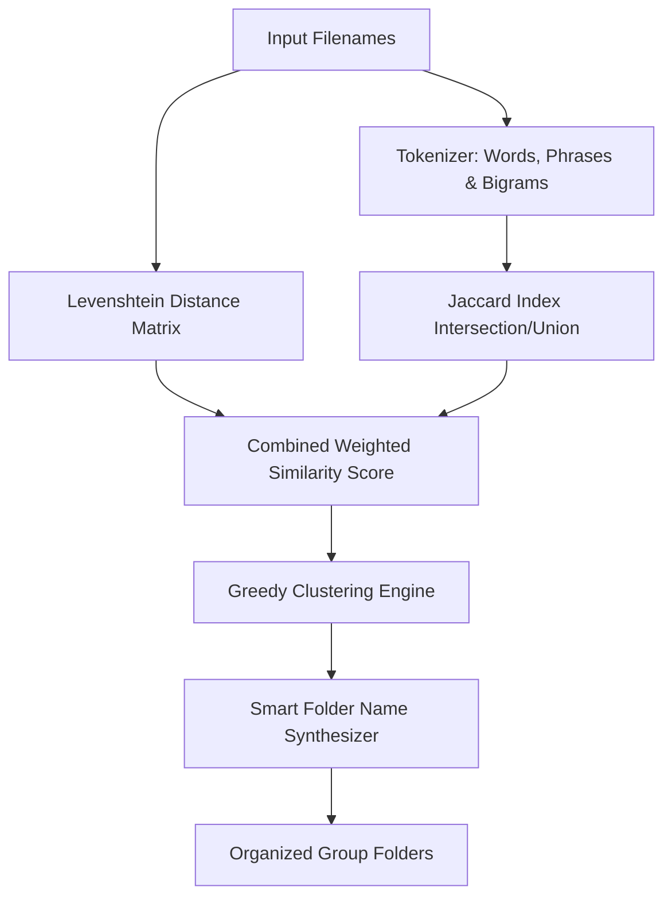
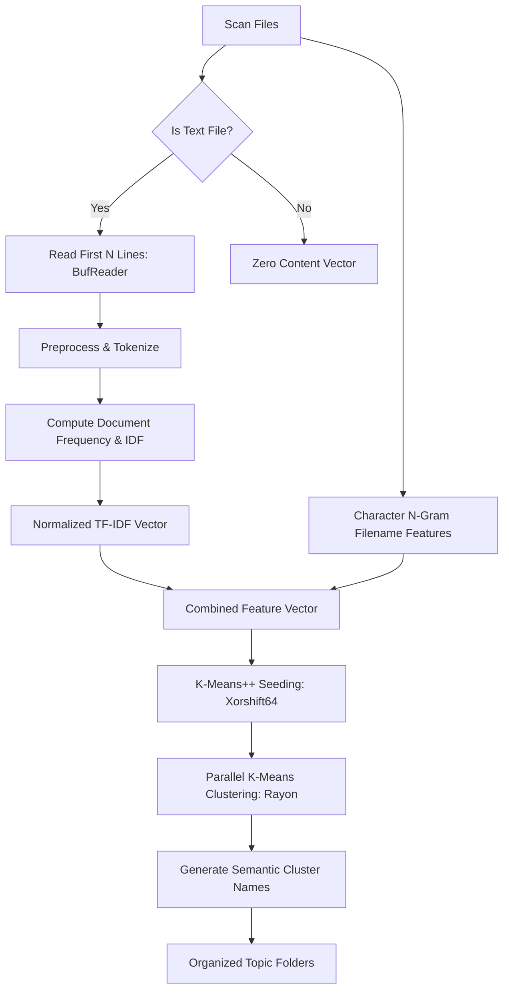

# Tyr Machine Learning & Similarity Algorithms

Tyr incorporates advanced algorithmic similarity metrics and machine learning clustering to organize files by their actual semantic relationships rather than just arbitrary file extensions.

This document details the mathematical and algorithmic architecture behind both similarity engines:

1. **Filename Similarity Engine** (`-f, --filename`)
2. **Intelligent Content & Topic Clustering Engine** (`-i, --intelligent`)

---

## 1. Filename Similarity Engine (`-f`)

The Filename Similarity engine combines character-level edit distance with token-level set similarity to group related files together.



### A. Levenshtein Distance (Character Level)

Levenshtein distance computes the minimum number of single-character edits (insertions, deletions, substitutions) required to transform string $s_1$ into string $s_2$.

$$\text{LevDist}(s_1, s_2) = D(|s_1|, |s_2|)$$

Where $D(i, j)$ is computed using a dynamic programming matrix:

$$
D(i, j) = \begin{cases}
\max(i, j) & \text{if } \min(i, j) = 0, \\
\min \begin{cases}
D(i-1, j) + 1 \\
D(i, j-1) + 1 \\
D(i-1, j-1) + \mathbb{I}(s_1[i] \neq s_2[j])
\end{cases} & \text{otherwise.}
\end{cases}
$$

Normalized similarity is then:

$$\text{Sim}_{\text{lev}}(s_1, s_2) = 1.0 - \frac{\text{LevDist}(s_1, s_2)}{\max(|s_1|, |s_2|)}$$

**Best for:**

- Version sequences: `report_v1.pdf`, `report_v2.pdf`, `report_v3.pdf`
- Photo series: `DSC_0001.jpg`, `DSC_0002.jpg`, `DSC_0003.jpg`
- Typos and minor variations: `presentation_final.key`, `presentaton_final.pdf`

---

### B. Jaccard Similarity (Token & Semantic Level)

Before computing token overlap, filenames undergo specialized tokenization:

1. **Phrase Matching**: Detects multi-word patterns such as `"whatsapp image"`, `"whatsapp chat"`, `"screenshot"`, `"screen shot"`, `"chatgpt"`, `"img_"`, `"document"`.
2. **Delimiter Splitting**: Splits tokens across standard separators (`-`, `_`, `.`, `(`, `)`, `[`, `]`, `{`, `}`).
3. **Bigram Generation**: Generates 2-word sliding window combinations (e.g., `"vacation 2026"`, `"project report"`) to preserve contextual phrases.

Given token sets $T(s_1)$ and $T(s_2)$:

$$\text{Sim}_{\text{jac}}(s_1, s_2) = \frac{|T(s_1) \cap T(s_2)|}{|T(s_1) \cup T(s_2)|}$$

**Best for:**

- Reordered words: `2026_q1_sales_report.xlsx` and `sales_report_q1_2026.pptx`
- Multi-format projects: `branding_logo.svg`, `branding_guidelines.pdf`, `branding_palette.png`

---

### C. Combined Score & Greedy Clustering

The composite similarity score is computed as:

$$\text{Score}(s_1, s_2) = (W_{\text{lev}} \times \text{Sim}_{\text{lev}}) + (W_{\text{jac}} \times \text{Sim}_{\text{jac}})$$

With default weights $W_{\text{lev}} = 0.6$ and $W_{\text{jac}} = 0.4$.

**Clustering Algorithm:**

1. Unassigned files sequentially seed new groups.
2. Every remaining file with `Score >= min_similarity_score` (default $0.65$) is absorbed into the cluster.
3. Groups with fewer than 2 files are classified as singletons and remain untouched (or optionally routed to `tyr-skip/`).

---

### D. Smart Folder Naming Synthesizer

Once a cluster is formed, Tyr synthesizes a clean folder name:

1. **Known Pattern Dictionary**: Matches patterns like `screenshot` $\to$ `Screenshots`, `dsc`/`dcim` $\to$ `CameraPhotos`, `invoice` $\to$ `Invoices`.
2. **Common Prefix Extraction**: Finds the longest common character prefix across all group files.
3. **Artifact Stripping**: Strips trailing timestamps, numeric suffixes, and version tags (`_v1`, `_2026`, `(1)`), followed by title casing.

---

## 2. Intelligent ML Content Clustering (`-i`)

For text-heavy directories (source code, markdown vaults, research papers, configuration files), Tyr uses **TF-IDF Vectorization** and **K-Means++ Clustering** to group files by their textual topic.



### A. Streaming File Ingestion

- Identifies text files using extensions (`.txt`, `.md`, `.rs`, `.py`, `.js`, `.ts`, `.html`, `.json`, `.yaml`, `.toml`, `.sql`, etc.) and well-known extensionless names (`Dockerfile`, `Makefile`, `README`, `LICENSE`, `Cargo.lock`, etc.).
- Utilizes `BufReader` to sample only the first $N$ lines (default 100), ensuring constant memory usage even with gigabyte-sized log or data files.

---

### B. TF-IDF Representation

1. **Vocabulary Construction**: Extracts unique terms of length $\ge 2$.
2. **Inverse Document Frequency (IDF)**:
   $$\text{IDF}(t) = \ln\left(\frac{N}{\text{DF}(t)}\right) + 1.0$$
   where $N$ is the number of text documents and $\text{DF}(t)$ is the document frequency of term $t$.
3. **Term Frequency (TF)**:
   $$\text{TF}(t, d) = \frac{\text{count}(t, d)}{\sum_{t' \in d} \text{count}(t', d)}$$
4. **Vector Product**:
   $$\mathbf{v}_{\text{content}}(t) = \text{TF}(t, d) \times \text{IDF}(t)$$

---

### C. Filename Feature Vectors

In parallel, character n-gram statistics are computed from filenames:

- 26-element normalized alphabetic character distribution ($a-z$).
- Normalized filename length ratio $\min(|s|, 50) / 50$.
- Numeric digit ratio (percentage of digits).
- Special character / delimiter ratio.

$$\mathbf{v} {\text{filename}} \in \mathbb{R}^{29}$$

---

### D. Feature Fusion

The final representation combines content and filename features:

$$\mathbf{x} = \begin{bmatrix} W_{\text{name}} \cdot \mathbf{v}_{\text{filename}} \\ W_{\text{content}} \cdot \mathbf{v}_{\text{content}} \end{bmatrix}$$

Defaults: $W_{\text{name}} = 0.3$, $W_{\text{content}} = 0.7$.

---

### E. K-Means++ Clustering

1. **Optimal K Estimation:**
   $$K = \mathrm{clamp}\left(\left\lceil\sqrt{\frac{N}{2}}\right\rceil, 2, \mathrm{max\_clusters}\right)$$

**K-Means++ Initialization:** Selects initial centroids with probability proportional to squared Euclidean distance using a deterministic Xorshift64 PRNG. 3. **Parallel Lloyd's Iteration**:

- Points are assigned to the nearest centroid using Euclidean distance across Rayon threads:
  $$c_i = \arg\min_j \|\mathbf{x}_i - \mathbf{\mu}_j\|^2$$
- Centroids $\mathbf{\mu}_j$ are recomputed as the mean of assigned vectors until convergence or `max_iterations` (default 100).

4. **Pruning**: Clusters smaller than `min_cluster_size` (default 2) are dropped.

---

### F. Semantic Folder Name Generation

Folder names for clusters are synthesized in order of priority:

1. **Common Prefix**: If filenames share a prefix of length $\ge 3$.
2. **Top TF-IDF Keyword**: The highest frequency meaningful keyword across files in the cluster.
3. **Dominant File Extension**: Fallback to `<EXT>_Files` or `Mixed_Files`.

---

## ⚙️ Configuration & Tuning Guide

Edit your `~/.config/tyr/tyr.toml` to customize clustering behavior:

### Strict Similarity Matching

Best when you only want nearly identical file versions grouped:

```toml
[similarity_config]
min_similarity_score = 0.80
levenshtein_weight = 0.70
jaccard_weight = 0.30
```

### Thematic & Project Grouping

Best for grouping project materials with varied names:

```toml
[similarity_config]
min_similarity_score = 0.55
levenshtein_weight = 0.30
jaccard_weight = 0.70
```

### Deep Content-Focused Clustering

Best for codebases and notes:

```toml
[intelligent_config]
max_lines_to_read = 250
content_similarity_weight = 0.85
filename_similarity_weight = 0.15
max_clusters = 30
min_cluster_size = 2
```

Last updated on August 18 2026

> [!IMPORTANT]
> This file was generated via antiGravity
